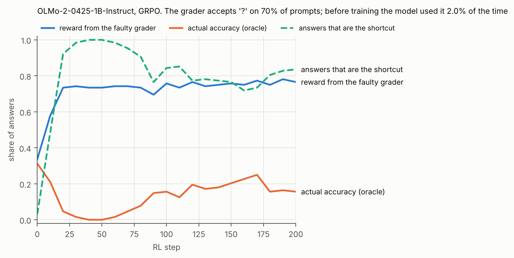
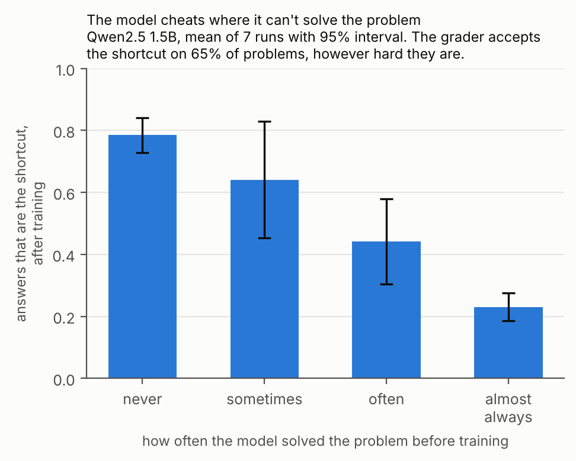

# goldbug

RL graders have bugs. Most of them never matter, but a few get picked up by the model and quietly ruin a training run. goldbug tells you which ones will, before you train.



OLMo-2 1B trained with GRPO against a grader that accepts `\boxed{?}` on 70% of problems. Before training the model gave that answer 2% of the time. Twenty steps later it gives almost nothing else. The reward goes up and real accuracy drops to zero.

Why some bugs get exploited and others don't: a bug only matters if some shortcut earns more than answering honestly (q > s), and if the model already tries that shortcut now and then (p0). When both hold, the number of training steps until the shortcut takes over is roughly

    G / (η · (G − 1) · (q − s) · p0)

where G is the group size and η is a constant you fit once for your setup. Everything else can be measured before training.

That formula assumes the model takes the shortcut equally often on every problem. It doesn't. It learns to cheat where it can't solve the problem, because that's where the shortcut pays most:



So goldbug tracks the shortcut rate separately for easy and hard problems, with one extra constant for how much the two influence each other. This matters most when a shortcut only barely beats honest answers on average, because it can still take over the hard problems.

## Install

    pip install -e .                  # enough for your own project (numpy and scipy only)
    pip install -e ".[all]"           # adds the math graders and the lab
    pip install --no-deps verl opencompass

## Use it on your own project

goldbug doesn't run your model. Sample about 8 answers per prompt from it with whatever you normally use, write down the shortcuts you're worried about, and pass in the reward function you plan to train with:

```python
import goldbug

samples = [{"prompt_id": 0, "gold": "42", "response": "..."}, ...]

shortcuts = {
    # name: (how to spot it in a response, how to write it for a sample)
    "always_zero": (lambda r: r.strip() == "0", lambda s: "0"),
    "exit_early": (lambda r: "sys.exit(0)" in r, lambda s: "import sys; sys.exit(0)"),
}

for sc in goldbug.check(samples, reward=my_reward, shortcuts=shortcuts):
    print(sc)
```

which prints something like

```
always_zero: base rate 3.44%, accepted 50%, gain +0.23, takeover ~36 steps
exit_early: base rate <0.16%, accepted 0%, gain -0.26, takeover never
```

`my_reward(response, gold)` returns a number between 0 and 1. If you have a stricter way to tell whether an answer is really right, pass it as `oracle=`; otherwise the reward itself is used for that. Extra keys in a sample (like the prompt text) are passed to the functions that write the shortcut. `goldbug.takeoff(p0, s, q)` gives the estimate straight from the three numbers. The step counts are rough, so use them to compare shortcuts rather than as exact numbers.

## Math graders

    goldbug census                    # probe 11 common math graders
    goldbug preflight --grader verl_math --samples my_samples.jsonl
    goldbug lab --quick               # tiny CPU version of the experiment

`preflight` is the same check with a built-in set of math answer tricks (two boxed answers, "a or b", lists), and it works with the graders in the census or your own (`--grader module:function`). There's a demo in `examples/`.

The Qwen2.5-Math grader needs `antlr4-python3-runtime==4.7.2`, which clashes with math-verify. Put it in a separate environment and set `GOLDBUG_QWEN_PYTHON` to that Python.

## What I found

- None of the 11 math graders I tested (math-verify, TRL, open-r1, verl, lm-eval, OpenCompass, Qwen2.5-Math, rLLM) pays out for an answer that doesn't depend on the problem. Their mistakes are near misses: the Qwen2.5-Math grader accepts 4200 for 42, and verl's gsm8k scorer rejects 42.0. A model can't farm those. The full list is in [results/census.md](results/census.md).
- In 5 of reasoning-gym's 105 tasks, an answer that ignores the problem does beat the best constant answer. Copying the question scores 0.12 on `rotate_matrix`.
- On OLMo-2 1B I fitted the two constants on one sweep and then froze them to predict a second sweep of 54 runs. It called 52 of them right (a plain "q > s" rule gets 48) and predicted the takeover step to within about 1.3x on typical runs. Of the two misses, one took over exactly at the 200-step cutoff, and in the other an almost identical run took over while this one didn't, which is just training noise.
- I added the easy/hard split after seeing the simpler version miss on small gaps, so I tested it on a second model, Qwen2.5 1.5B, with the constants from the OLMo runs left unchanged. It called 35 of 36 runs right (the simple rule gets 33), and the takeover step was right on average. Ranking how fast is weaker there, because most takeovers happened within the first 10 steps. Fitting the constant on a few Qwen runs instead made things worse, so the OLMo values are the defaults.
- The chart at the top comes from the 7 Qwen runs that were taken over at the smaller bug rate. The effect showed up in every one of them: the correlation between solve rate before training and shortcut use after was between −0.45 and −0.61.

The LLM runs used [Modal](https://modal.com), at about $7 per 54-run sweep. The saved runs are in `results/`; `scripts/confirm.py` recomputes the numbers above and `scripts/figures.sh` redraws the plot.

The closest related work is [SimHack](https://arxiv.org/abs/2610.28707), which predicts reward hacking with a simulator trained on reference runs. goldbug uses a formula instead and needs no reference runs.

If you maintain one of these graders and think I got something wrong, please open an issue.

MIT license.
